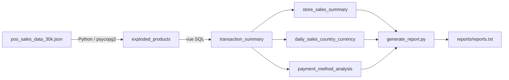

Arborescence finale


sports-sales-data-pipeline/
├── dags/sports_sales_pipeline.py
├── data/raw/pos_sales_data_30k.json
├── sql/
│   ├── ddl/01_create_tables.sql
│   ├── transformations/   02_transaction_summary.sql, 03_..., 04_..., 05_...
│   ├── quality/06_data_quality_checks.sql
│   └── analytics/07_analytics_queries.sql
├── scripts/load_json.py, generate_report.py, run_pipeline.sh
├── reports/
├── logs/
├── docker-compose.yml
├── .env.example
├── .gitignore
└── README.md


# Sports Sales Data Pipeline

Pipeline ETL qui transforme 30 000 tickets de caisse JSON (réseau de magasins de sport, 2023-2025) en tables analytiques PostgreSQL, orchestré par Airflow et déployé avec Docker Compose.

**Philosophie** : Python pour ingérer, SQL pour transformer et agréger, Airflow pour orchestrer, Docker pour déployer, Git pour versionner.

## Architecture



Le DAG Airflow `sports_sales_pipeline` enchaîne :
`create_tables` → `load_json` → `create_transaction_summary` → `check_data_quality` → 3 tables KPI en parallèle → `generate_report`.

## Technologies

| Outil | Rôle |
|---|---|
| Python 3 + psycopg2 | Lecture du JSON, explosion de `products[]`, chargement |
| PostgreSQL 16 | Stockage et transformations SQL |
| Apache Airflow 2.10 (LocalExecutor) | Orchestration quotidienne |
| Docker Compose | Environnement complet |
| pgAdmin | Interface de consultation |

## Structure du dépôt

```text
dags/            DAG Airflow
data/raw/        JSON source
sql/ddl/         création des tables
sql/transformations/  vue transaction_summary + 3 tables KPI
sql/quality/     contrôles de qualité
sql/analytics/   12 requêtes du lab
scripts/         load_json.py, generate_report.py, run_pipeline.sh
reports/         rapport généré
```

## Modèle de données

| Table | Granularité |
|---|---|
| `exploded_products` | 1 ligne par produit vendu (59 928 lignes) |
| `transaction_summary` (vue) | 1 ligne par ticket (30 000) |
| `store_sales_summary` | 1 ligne par (store_id, nom, pays, ville, type) |
| `daily_sales_country_currency` | 1 ligne par jour / pays / devise |
| `payment_method_analysis` | 1 ligne par moyen de paiement |

## Installation

Prérequis : Docker Desktop, 4 Go de RAM alloués à Docker.

```bash
cp .env.example .env        # puis modifier les mots de passe
# placer pos_sales_data_30k.json dans data/raw/
docker compose up -d
docker compose ps -a        # attendre healthy ; airflow-init termine en Exited (0)
```

## Utilisation

- Airflow : http://localhost:8080 (identifiants du `.env`)
- pgAdmin : http://localhost:8082 (serveur `postgres_dw`, port 5432)
- PostgreSQL depuis la machine : `localhost:5434`

Déclencher le pipeline :

```bash
docker compose exec airflow-scheduler airflow dags trigger sports_sales_pipeline
```

Le rapport est écrit dans `reports/reports.txt`. Pour tout enchaîner : `./scripts/run_pipeline.sh`.

## Règles métier et qualité des données

- **Pas de double comptage** : `total_amount` est répété sur chaque ligne produit après explosion. Toutes les agrégations passent par la vue `transaction_summary` (1 ligne par ticket).
- **Montants bruts** : `total_amount` est égal à la somme prix × quantité, avant remise. `discount_applied` est une information distincte.
- **Retours** : les transactions retournées sont incluses dans le chiffre d'affaires. Le taux de retour est calculé séparément.
- **Pas de conversion de devises** : les montants de devises différentes ne sont jamais additionnés comme s'ils étaient comparables.
- **`store_id` n'identifie pas un magasin physique** : le jeu de données (synthétique) associe un même `store_id` à plusieurs noms, pays et villes (8 681 `store_id` pour 29 930 combinaisons). Un magasin est donc défini par `(store_id, nom, pays, ville, type)`.
- **Full refresh** : chaque exécution recharge tout (TRUNCATE + INSERT), donc le DAG est rejouable sans doublons.
- **Contrôles** : la tâche `check_data_quality` bloque les KPI si les données sont vides, invalides ou incohérentes.

## Résultats

(extrait)

SPORTS SALES DATA PIPELINE - ANALYTICS REPORT
Genere le 2026-11-04 21:31:35
======================================================================

NOTES
  - Les montants sont bruts, avant remise (total_amount = somme prix x quantite).
  - Les devises ne sont pas converties : ne comparez pas des montants de devises differentes.
  - store_id n'identifie pas un magasin physique : un magasin = (store_id, nom, pays, ville, type).

======================================================================
1. STORE SALES ANALYSIS (store_sales_summary)
======================================================================

[store_1] Top 5 des magasins par chiffre d'affaires (devises locales)
store_id | store_name       | store_country | store_city  | total_sales_amount
---------+------------------+---------------+-------------+-------------------
STR6060  | Champion Gear    | United States | Los Angeles | 4,200.00          
STR3926  | Pro Fitness      | Italy         | Naples      | 4,029.00          
STR6770  | Active Life      | Netherlands   | Utrecht     | 3,800.00          
STR3429  | Pro Fitness      | Japan         | Tokyo       | 3,780.00          
STR2758  | Athlete's Corner | France        | Nice        | 3,780.00          

[store_2] Ville avec le chiffre d'affaires cumule le plus eleve
store_city | store_country | total_sales
-----------+---------------+------------
Eindhoven  | Netherlands   | 308,493.50 

[store_3] Nombre de magasins par pays
store_country        | nb_magasins_combinaisons | nb_store_id_distincts
---------------------+--------------------------+----------------------
Mexico               | 1709                     | 1571                 
Netherlands          | 1698                     | 1551                 
India                | 1696                     | 1546                 
South Korea          | 1695                     | 1551                 
France               | 1680                     | 1521                 
China                | 1679                     | 1539                 
Vietnam              | 1674                     | 1534                 
United Arab Emirates | 1671                     | 1520                 
Spain                | 1665                     | 1516                 
Germany              | 1663                     | 1520                 
United States        | 1663                     | 1500                 
Japan                | 1658                     | 1505                 
Saudi Arabia         | 1651                     | 1512                 
United Kingdom       | 1649                     | 1504                 
Italy                | 1639                     | 1508                 
Thailand             | 1627                     | 1495                 
Canada               | 1616                     | 1472                 
Indonesia            | 1597                     | 1450                 

[store_4] Quantite totale de produits vendus par pays
store_country        | total_quantity
---------------------+---------------
South Korea          | 10440         
Mexico               | 10315         
United Arab Emirates | 10246         
France               | 10174         
Netherlands          | 10162         
Saudi Arabia         | 10162         
Vietnam              | 10134         
Japan                | 10117         
China                | 10087         
India                | 10038         
Spain                | 9978          
United States        | 9865          
Germany              | 9841          
Canada               | 9766          
Thailand             | 9750          
Italy                | 9733          
United Kingdom       | 9706          
Indonesia            | 9577          

## Pistes d'amélioration

- Chargement incrémental
- Table de taux de change pour comparer les devises
- Tests automatisés SQL / Python
- Tableau de bord (Power BI, Metabase)
- Migration de la logique SQL vers dbt